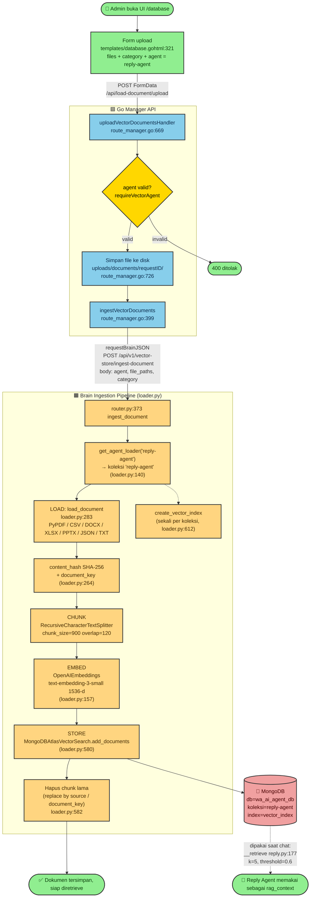
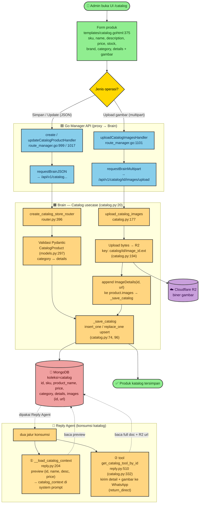

# Flowchart Arsitektur — Reply Agent (AI Agent Resepsionis)

> **Cakupan dokumen:** Semua flowchart di bawah **hanya berfokus pada Reply Agent** (AI Agent Resepsionis / "Sofia") — jalur auto-reply resepsionis dan tooling yang dipakainya. Orkestrasi (main/code/research agent) sengaja **di-skip** sesuai permintaan.
>
> Sumber kebenaran: analisis langsung dari kode di `internal/` (Go) dan `brain/` (Python). Setiap node mencantumkan referensi `file:line` agar bisa ditelusuri.

## Legenda warna

| Warna | Simbol | Arti |
|-------|--------|------|
| 🟢 Hijau | 👤 📱 | Aktor: User / Admin / WhatsApp |
| 🔵 Biru | — | Go runtime (`wa-agent` / Gin) |
| 🟠 Oranye | — | Python Brain (FastAPI / usecase) |
| 🟣 Ungu | — | Node internal LangGraph |
| 🔴 Merah | 💾 | Penyimpanan data (MongoDB) |
| ☁️ Lilac | ☁️ | Cloudflare R2 (gambar) |
| 🟡 Kuning | — | Titik keputusan (decision) |
| 🌸 Pink | ⚠️ | Jalur peringatan / terminasi negatif |

---

## (a) Flowchart Reply Agent — End-to-End (User → AI Agent → User)

Mekanisme end-to-end: pesan WhatsApp masuk ditangkap WhatsMeow → dirutekan ke Reply Agent → Brain menjalankan graph LangGraph (guardrail → retrieve RAG → load context katalog & custom tool → conversation + tool calling) → balasan dikirim balik ke WhatsApp. **Penting:** teks balasan **tidak** dikembalikan lewat HTTP response Go→Brain (response-nya hanya `{"status":"success"}`); Brain justru **mendorong** balasan secara terpisah ke endpoint Gin `/v1/message/send`.

```mermaid
flowchart TD
    classDef user fill:#90EE90,stroke:#333,stroke-width:2px,color:#0a3d0a
    classDef go fill:#87CEEB,stroke:#333,stroke-width:2px,color:#0a2a4a
    classDef brain fill:#FFD580,stroke:#333,stroke-width:2px,color:#4a2a00
    classDef graph fill:#E6E6FA,stroke:#333,stroke-width:2px,color:#2a2a4a
    classDef db fill:#F0A0A0,stroke:#333,stroke-width:2px,color:#4a0000
    classDef decision fill:#FFD700,stroke:#333,stroke-width:2px,color:#000000
    classDef warn fill:#FFB6C1,stroke:#DC143C,stroke-width:2px,color:#000000

    Start(["📱 Pesan masuk dari User WhatsApp"]):::user

    subgraph "🟦 Go WhatsApp Runtime (wa-agent)"
        EH["event handler<br/>handler/bot.go:25"]:::go
        HME["HandleMessageEvent<br/>usecase/agent/services.go:404"]:::go
        ACC{"Akses diizinkan dan<br/>AIReply.Enable?<br/>services.go:182, 205"}:::decision
        AUTO["autoReplyAIHandler<br/>services.go:288"]:::go
        CMD["/reply command<br/>command.go:1085"]:::go
        REPLY["responder.Reply REPLY_AGENT_ROUTE<br/>usecase/chat/service.go:31"]:::go
        CC["BrainAPI.ChatCompletion<br/>infrastructure/ai/api/connection_to_brain.go:197"]:::go
    end

    Start --> EH --> HME --> ACC
    ACC -->|"auto-reply (resepsionis)"| AUTO
    ACC -->|"/reply manual"| CMD
    AUTO --> REPLY
    CMD --> REPLY --> CC

    CC -->|"POST /api/v1/agent-reply<br/>payload: Number, Message, GroupID"| ROUTER

    subgraph "🟧 Python Brain — Reply Agent 'Sofia' (reply.py)"
        ROUTER["FastAPI route / BackgroundTask<br/>interface/api/router.py:295"]:::brain
        RA["ReplyAgentUsecase.ReplyAgent<br/>reply.py:1034"]:::brain
        SYSOP{"is_system?<br/>(injek operator)"}:::decision
        ESC{"waiting_for_admin?<br/>reply.py:1063"}:::decision
        REGEX{"regex prompt-injection?<br/>reply.py:1067"}:::decision
        WARN["Kirim PROMPT_INJECTION_WARNING<br/>lalu return"]:::warn
        POST["post-process:<br/>extract + scope_filter<br/>+ WhatsApp format<br/>reply.py:1088-1109"]:::brain
        SCORE[("capture_agent_log<br/>→ koleksi scoring")]:::db
        SEND["request_send_message<br/>tools/whatsapp_integration.py:177"]:::brain

        subgraph "LangGraph react_graph.ainvoke (reply.py:1009)"
            GR["guardrail<br/>LLM judge (reply.py:361)"]:::graph
            RET["retrieve (RAG)<br/>k=5, score_threshold=0.6<br/>(reply.py:161)"]:::graph
            CAT["load_catalog_context<br/>(reply.py:204)"]:::graph
            CTC["load_custom_tool_context<br/>(reply.py:438)"]:::graph
            CONV["conversation<br/>LLM + bind_tools<br/>(reply.py:735)"]:::graph
            TC{"tool_calls?"}:::decision
            TN["tool_node<br/>ToolNode.ainvoke (reply.py:531)"]:::graph
            AFTER{"catalog_message_sent?"}:::decision
            FOLLOW["catalog_follow_up<br/>(reply.py:897)"]:::graph
            SUM["summarize_conversation<br/>jika lebih dari 30 pesan (reply.py:937)"]:::graph
        end
    end

    ROUTER --> RA --> SYSOP
    SYSOP -->|"ya: injek [Operator], return"| SYSEND(["⏹️ selesai tanpa balasan AI"]):::warn
    SYSOP -->|tidak| ESC
    ESC -->|"ya: dilewati ke admin"| SILENT(["🤫 AI diam, auto-enable 30 mnt"]):::warn
    ESC -->|tidak| REGEX
    REGEX -->|"cocok"| WARN
    REGEX -->|aman| GR

    GR -->|"safe"| RET
    GR -->|"unsafe"| GNONE(["⏹️ END tanpa balasan"]):::warn
    RET --> CAT --> CTC --> CONV
    CONV --> TC
    TC -->|"ada tool_calls"| TN
    TC -->|"tidak ada"| SUM
    TN --> AFTER
    AFTER -->|"catalog terkirim"| FOLLOW
    AFTER -->|"lanjut chat"| CONV
    FOLLOW --> POST
    SUM --> POST

    RET -.->|"baca vector"| VDB[("koleksi: reply-agent<br/>vector_index 1536-d")]:::db
    CAT -.->|"baca preview"| CDB[("koleksi: catalog")]:::db
    CTC -.->|"baca definisi"| TDB[("koleksi: tools_builder")]:::db

    CONV -.->|"tool: broadcast_to_admins<br/>(user minta admin / CS)"| ESCDB[("disable_ai_reply<br/>escalation_log TTL 30 mnt")]:::db
    ESCDB -.->|"notifikasi semua admin"| ADMINS(["👤👤 Admin / CS WhatsApp"]):::user

    WARN --> SEND
    POST --> SCORE
    POST --> SEND
    SEND -->|"POST /v1/message/send"| GIN

    subgraph "🟦 Go Gin Server"
        GIN["sendMessageHandler<br/>presentation/http/route.go:99"]:::go
        ST["handler.SendMessage<br/>→ WhatsMeow SendText"]:::go
    end

    GIN --> ST
    ST --> End(["📱 Balasan AI ke User WhatsApp"]):::user
```

### Penjelasan mekanisme (a)

**1. Incoming — WhatsApp → Go.** WhatsMeow memanggil event handler di [handler/bot.go:25](internal/presentation/handler/bot.go#L25). Pesan di-dispatch ke [HandleMessageEvent](internal/usecase/agent/services.go#L404) yang mengunci per-chat, lalu mengecek akses ([CheckAccess](internal/usecase/agent/services.go#L182)) dan flag [AIReply.Enable](internal/usecase/agent/services.go#L205). Reply Agent hanya dipanggil lewat dua pintu: **auto-reply** untuk pengirim yang tidak terdaftar ([autoReplyAIHandler](internal/usecase/agent/services.go#L288)) atau **command `/reply`** ([command.go:1085](internal/usecase/agent/command.go#L1085)). Keduanya memakai konstanta `REPLY_AGENT_ROUTE = "agent-reply"`. (Catatan: pengirim *allowed sender* tanpa `/reply` jatuh ke `chat-agent` / main agent — di-skip di sini.)

**2. Go → Brain.** [Service.Reply](internal/usecase/chat/service.go#L31) → [BrainAPI.ChatCompletion](internal/infrastructure/ai/api/connection_to_brain.go#L197) melakukan `POST /api/v1/agent-reply` dengan payload `{Number, Message, IsSystem, GroupID, ...}`, timeout 360 detik.

**3. Brain — pre-flight gates.** [ReplyAgentUsecase.ReplyAgent](brain/backend/application/ai/reply.py#L1034) menjalankan gerbang berurutan: `is_system` (injeksi pesan `[Operator]`), [get_waiting_for_admin](brain/backend/application/ai/reply.py#L1063) (esc. gate — AI diam), lalu [input_sanitizer_node](brain/backend/application/ai/reply.py#L1067) (regex prompt-injection).

**4. Brain — LangGraph.** [react_graph.ainvoke](brain/backend/application/ai/reply.py#L1077) menjalankan node: `guardrail` (LLM judge) → `retrieve` (RAG dari koleksi `reply-agent`, `k=5`, `threshold=0.6`) → `load_catalog_context` (preview katalog) → `load_custom_tool_context` (dari `tools_builder`) → `conversation` (LLM `bind_tools`). Tool yang terikat: `get_catalog_tool_by_id`, `broadcast_to_admins` (eskalasi), serta custom tools bila ada. Setelah `tool_node`, bila catalog tool sudah mengirim detail → `catalog_follow_up`; jika >30 pesan → `summarize_conversation`.

**5. Post-process.** [extract + scope_filter + format WhatsApp](brain/backend/application/ai/reply.py#L1088) lalu [capture_agent_log](brain/backend/application/ai/reply.py#L1096) menulis ke koleksi `scoring`.

**6. Outgoing — Brain → WhatsApp.** [request_send_message](brain/backend/application/ai/tools/whatsapp_integration.py#L177) mem-PUSH `POST /v1/message/send` ke Gin server Go → [sendMessageHandler](internal/presentation/http/route.go#L99) → WhatsMeow `SendText` → user.

**7. Eskalasi ke manusia.** Saat LLM memanggil tool `broadcast_to_admins`, sistem memanggil `disable_ai_reply` yang menulis `escalation_log` (TTL 30 menit) dan mengirim notifikasi ke semua nomor admin. Setelah itu setiap pesan user berikutnya terkena gate `waiting_for_admin` → AI diam, sampai di-enable ulang (manual atau setelah 30 menit).

---

## (b) Flowchart Upload Document Knowledge (UI → Database)

Mekanisme: admin upload dokumen lewat UI `/database` → Go menyimpan file ke disk & meneruskan *path* ke Brain → pipeline ingestion Brain melakukan **load → chunk → embed → store** ke MongoDB Atlas Vector Search pada koleksi per-agent (`reply-agent`). Dokumen ini nanti diretrieve Reply Agent sebagai `rag_context`.



### Penjelasan mekanisme (b)

1. **UI.** Halaman [GET /database](internal/presentation/http/route_frontend.go#L627) merender form di [database.gohtml:321](internal/presentation/templates/database.gohtml#L321). Form mengirim `FormData(files, category, agent=reply-agent)` ke `POST /api/load-document/upload`.
2. **Go handler.** [uploadVectorDocumentsHandler](internal/presentation/http/route_manager.go#L669) memvalidasi agent, menyimpan file fisik ke `uploads/documents/<requestID>/` (file **tidak** di-stream ke Brain — hanya *path absolut*-nya yang dikirim, karena Brain berbagi filesystem yang sama via `DOCUMENT_STORAGE_DIR`), lalu [ingestVectorDocuments](internal/presentation/http/route_manager.go#L399) meneruskan ke Brain.
3. **Brain pipeline.** [ingest_document](brain/backend/interface/api/router.py#L373) → [DocumentLoader.ingest_to_mongodb](brain/backend/application/ingestion/loader.py#L485): **load** (dispatcher ekstensi), **chunk** (`RecursiveCharacterTextSplitter`, 900/120), **embed** (`OpenAIEmbeddings text-embedding-3-small`, 1536-dim), **store** (`MongoDBAtlasVectorSearch.add_documents`), lalu **cleanup** chunk lama berdasarkan `source`/`document_key`.
4. **Database.** Satuan chunk disimpan di koleksi `reply-agent` (db `wa_ai_agent_db`) dengan field `text`, `embedding`, `source`, `category`, `chunk_id`, `ingest_batch_id`, dll., di bawah Atlas Vector Search index `vector_index`.
5. **Konsumsi Reply Agent.** Node `retrieve` di [reply.py:177](brain/backend/application/ai/reply.py#L177) memanggil `similarity_search_with_relevance_scores(k=5, threshold=0.6)` pada koleksi & index yang sama → menjadi `rag_context` di system prompt.

---

## (c) Flowchart Menambahkan Custom Tools (UI → Database)

> ⚠️ **Insight arsitektur penting:** Custom Tools **tidak** lewat Brain API. Go Manager menulis **langsung** ke MongoDB koleksi `tools_builder`. Brain hanya **membaca** koleksi yang sama setiap turn untuk membangun `StructuredTool` saat runtime.

```mermaid
flowchart TD
    classDef user fill:#90EE90,stroke:#333,stroke-width:2px,color:#0a3d0a
    classDef go fill:#87CEEB,stroke:#333,stroke-width:2px,color:#0a2a4a
    classDef brain fill:#FFD580,stroke:#333,stroke-width:2px,color:#4a2a00
    classDef db fill:#F0A0A0,stroke:#333,stroke-width:2px,color:#4a0000
    classDef decision fill:#FFD700,stroke:#333,stroke-width:2px,color:#000000
    classDef note fill:#FFFACD,stroke:#333,stroke-width:1px,color:#333333

    NOTE["⚠️ Catatan: penulisan GO → MongoDB langsung (TANPA Brain API).<br/>Brain hanya MEMBACA koleksi tools_builder."]:::note

    Start(["👤 Admin buka UI /toolsbuilder"]):::user
    FORM["Form definisi tool<br/>templates/toolsbuilder.gohtml:978<br/>agent_type=reply-agent, name, description,<br/>information, code (package + source)"]:::user
    Start --> FORM
    FORM -->|"POST JSON<br/>/api/tool-builder/tools<br/>(atau PUT untuk update)"| GH

    subgraph "🟦 Go Manager API (tulis langsung ke Mongo)"
        GH["addToolBuilderHandler<br/>route_manager.go:872"]:::go
        VAL{"validateToolBuilderData<br/>(name + description +<br/>information atau code)"}:::decision
        DUP{"duplikat<br/>{agent_type, name}?"}:::decision
        DOM["toolBuilderRequestToDomain<br/>route_manager.go:328"]:::go
        MGR["manager.AddToolBuilder<br/>usecase/manager/tools_builder.go:87"]:::go
        INS["MongoManager.InsertOne"]:::go
    end

    GH --> VAL
    VAL -->|valid| DUP
    VAL -->|invalid| ERR(["400 ditolak"]):::user
    DUP -->|tidak| DOM --> MGR --> INS
    DUP -->|ya| ERR

    INS --> MDB[("💾 MongoDB<br/>koleksi=tools_builder<br/>name, description, agent_type,<br/>information, code (package, code)")]:::db
    INS --> Done(["✅ Tool tersimpan"]):::user

    MDB -.->|"dibaca Brain tiap turn"| READ

    subgraph "🟧 Brain (READ side — bangun tool saat runtime)"
        READ["_load_tools<br/>tools_builder.py:163<br/>filter agent_type=reply-agent"]:::brain
        BUILD["make_custom_database_tools<br/>→ StructuredTool<br/>tools_builder.py:582"]:::brain
        GATE["gateway tools:<br/>find_relevant_tools_builder,<br/>execute_tools_builder<br/>(tools_builder.py:544, 562)"]:::brain
    end

    READ --> BUILD --> GATE
    GATE -.->|"bind ke LLM"| BIND

    subgraph "🤖 Reply Agent (binding)"
        BIND["__get_tools<br/>reply.py:499"]:::brain
        CTX["__load_custom_tool_context<br/>reply.py:438<br/>→ custom_tool_context di prompt"]:::brain
        EXEC["saat dipanggil: run_custom_tool<br/>subprocess + auto pip install<br/>tools_builder.py:454"]:::brain
    end

    BIND --> CTX
    CTX -.-> EXEC
```



### Penjelasan mekanisme (c)

1. **UI.** [GET /toolsbuilder](internal/presentation/http/route_frontend.go#L633) merender workbench [toolsbuilder.gohtml](internal/presentation/templates/toolsbuilder.gohtml). Form mengirim `{agent_type, name, description, information, code{package, code}}` ke `POST /api/tool-builder/tools`. Agent yang didukung termasuk `reply-agent`.
2. **Go handler (tulis langsung).** [addToolBuilderHandler](internal/presentation/http/route_manager.go#L872) memvalidasi via [validateToolBuilderData](internal/usecase/manager/tools_builder.go#L40), cek duplikat `{agent_type, name}`, lalu [manager.AddToolBuilder](internal/usecase/manager/tools_builder.go#L87) melakukan **`MongoManager.InsertOne` langsung** ke koleksi `tools_builder`. **Tidak ada panggilan ke Brain.**
3. **Database (shared).** Koleksi `tools_builder` di db `wa_ai_agent_db`. Karena Go dan Brain konek ke instance Mongo yang sama, tulisan Go langsung terlihat oleh Brain.
4. **Brain — build tool (lazy, saat runtime).** [ToolsBuilder._load_tools](brain/backend/application/ai/tools/tools_builder.py#L163) membaca doc `agent_type=reply-agent` setiap turn, [make_custom_database_tools](brain/backend/application/ai/tools/tools_builder.py#L582) membungkusnya jadi `StructuredTool`. Gateway tools `find_relevant_tools_builder` + `execute_tools_builder` selalu tersedia bila ada custom tool.
5. **Binding Reply Agent.** [__get_tools](brain/backend/application/ai/reply.py#L499) mem-bind gateway tools; [__load_custom_tool_context](brain/backend/application/ai/reply.py#L438) menyuntikkan ringkasan tool ke `custom_tool_context` di system prompt. Saat dijalankan, [run_custom_tool](brain/backend/application/ai/tools/tools_builder.py#L454) mengeksekusi kode Python via `subprocess` dengan **auto `pip install`** paket yang terdaftar.

---

## (d) Flowchart Setup Katalog (UI → Database)

Mekanisme: admin mengelola produk katalog (teks + gambar) lewat UI `/catalog` → Go mem-proxy ke Brain → `Catalog` usecase menyimpan dokumen produk ke MongoDB koleksi `catalog`, sedangkan **biner gambar** disimpan di Cloudflare R2 (hanya URL yang disimpan di Mongo). Reply Agent mengkonsumsi katalog lewat dua jalur: preview di system prompt + tool `get_catalog_tool_by_id`.



### Penjelasan mekanisme (d)

1. **UI.** [GET /catalog](internal/presentation/http/route_frontend.go#L639) merender [catalog.gohtml](internal/presentation/templates/catalog.gohtml). JS membangun payload produk (`buildPayload`) dan memanggil `/api/catalog-store/products*` untuk CRUD, atau upload gambar ke `/products/:id/images/upload`.
2. **Go handler (proxy).** Handler di [route_manager.go:963-1167](internal/presentation/http/route_manager.go#L963) memvalidasi (mis. allowlist ekstensi gambar) lalu meneruskan via [requestBrainJSON](internal/presentation/http/route_manager.go#L131) (JSON) atau [requestBrainMultipart](internal/presentation/http/route_manager.go#L198) (gambar) ke Brain `/api/v1/catalog...`.
3. **Brain storage.** [Catalog](brain/backend/application/ai/tools/catalog.py#L20) memvalidasi via model [CatalogProduct](brain/backend/application/ai/tools/models.py#L297) (relasi `category ↔ details`), lalu [_save_catalog](brain/backend/application/ai/tools/catalog.py#L74) menulis/`upsert` ke koleksi `catalog`. Untuk gambar, [upload_catalog_images](brain/backend/application/ai/tools/catalog.py#L177) mengunggah bytes ke **Cloudflare R2** di key `catalog/{id}/{image_id}{ext}`, lalu hanya menyimpan URL (`ImageDetails(id, url)`) ke field `product.images`.
4. **Database.** Koleksi `catalog` di db `wa_ai_agent_db`; biner gambar di R2 (Mongo hanya menyimpan URL publik).
5. **Konsumsi Reply Agent — dua jalur.** ① [__load_catalog_context](brain/backend/application/ai/reply.py#L204) memuat **preview** (`id, product_name, description, price`) sebagai JSON `catalog_context` di system prompt agar LLM tahu produk apa yang tersedia. ② Tool [get_catalog_tool_by_id](brain/backend/application/ai/tools/catalog.py#L332) (`return_direct`) mengambil full dokumen by id dan **mengirim detail + gambar langsung ke WhatsApp**; setelah itu node `catalog_follow_up` membuat tindak lanjut singkat agar AI tidak mengulang seluruh payload.

---

## Ringkasan datastore yang disentuh Reply Agent & 3 flow setup

| Koleksi MongoDB (`wa_ai_agent_db`) | Ditulis oleh | Dibaca oleh Reply Agent | Peran |
|---|---|---|---|
| `reply-agent` | flow (b) ingestion | node `retrieve` (RAG) | Vektor dokumen pengetahuan |
| `catalog` | flow (d) Catalog CRUD | `load_catalog_context` + tool `get_catalog_tool_by_id` | Produk & harga |
| `tools_builder` | flow (c) Go langsung | `load_custom_tool_context` + gateway tools | Definisi custom tool |
| `reply_agent_checkpoints` / `_writes` | Reply Agent (LangGraph) | Reply Agent | State percakapan (TTL 1 minggu) |
| `escalation_log` | tool `broadcast_to_admins` / API `/escalation` | gate `waiting_for_admin` | Daftar tunggu admin (TTL 30 mnt) |
| `manager_bot_config` | Admin number-store | `broadcast_to_admins`, config LLM/provider | Daftar admin & konfigurasi |
| `scoring` | `capture_agent_log` | perintah `/show-agent-score` | Evaluasi (RAGAS + cosine) |
| `tmp_messages` | on-hold send | konfirmasi `/send` `/unsend` | Pesan tertahan ke pihak ketiga |

| Penyimpanan lain | Isi |
|---|---|
| **Cloudflare R2** | Biner gambar katalog (`catalog/{id}/{image_id}{ext}`) |
| **Atlas Vector Search index `vector_index`** | Index 1536-dim pada tiap koleksi agent (`reply-agent`, dll.) |
| **Redis** | Log sesi input history (`session:{sender}:{func}:{id}`) |
| **Disk `uploads/documents/`** | File mentah hasil upload (dibaca Brain saat ingestion) |
