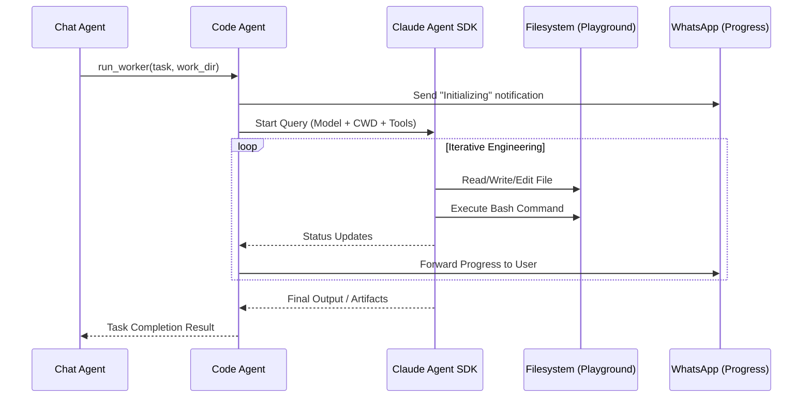

# Code Agent

## Overview
The **Code Agent** (implemented as `AgentCodeUsecase`) is a highly specialized sub-agent designed for complex engineering tasks. It leverages the **Claude Agent SDK** to perform iterative reasoning, file editing, and terminal execution within a sandboxed "playground".

## Workflow

<!-- Code Agent execution sequence -->

## Step-by-Step Workflow
1. **Trigger**: Invoked via the `run_worker` tool from the main Chat Agent.
2. **Session / DB / Workspace**: Automatically looks up existing `session_id`, safely maps the requested `work_dir` to a directory inside the `playground/` root, and retrieves context from the `CODE_AGENT` RAG collection.
3. **SDK Initialization**: Prepares `ClaudeAgentOptions`, including:
    - **Model Selection**: Fallback logic between Anthropic and Ollama models.
    - **MCP Tools**: Registers custom tools like `websearch`, `get_screen_commands`, `generate_images`, `find_relevant_custom_tools`, and `execute_custom_tool`.
    - **Native Tools**: Provides `Bash`, `Read`, `Write`, `Edit`, `LS`, etc.
4. **Iterative Execution**: The SDK runs a loop of thinking and tool-using until the goal is met or a timeout occurs (default 10 minutes).
5. **Progress Tracking**: Real-time notifications are sent back to the user via WhatsApp (`🤖✨ Worker job [step] ...`).
6. **Result Capture**: Collects final logs, created files, and status messages to return to the supervisor.

## Tool Access
The Code Agent has its own dedicated toolset (via MCP and native SDK tools):
- **Filesystem**: `Read`, `Write`, `Edit`, `Glob`, `LS`.
- **System**: `Bash` (Terminal execution).
- **Custom MCP**: `websearch`, `get_screen_commands` (tmux), `generate_images`.
- **Database / Internal**: `find_relevant_custom_tools`, `execute_custom_tool`.

## Technical Advantages
- **Sandboxing**: All operations are restricted to the `playground/` directory, preventing accidental modification of the host system's core files.
- **Persistence**: Supports `session_id` to resume work from previous turns, including all previous tool history and reasoning.
- **Path Mapping**: Intelligent handling of Windows vs. Linux paths, allowing the agent to function correctly in containerized environments regardless of the host OS.
- **Monkey-Patching**: Includes a compatibility patch for Ollama to handle thinking-block signatures correctly.

## Output Contract
- **Type**: Detailed string summary.
- **Content**: Breakdown of files created/modified, commands run, and the final result of the task.

## Related Documents
- [Chat Agent](chat-agent.md) — The supervisor.
- [Tools Overview](../brain/overview.md) — Available system tools.
- [Tech Stack](../stack/tech-stack.md) — SDK details.
