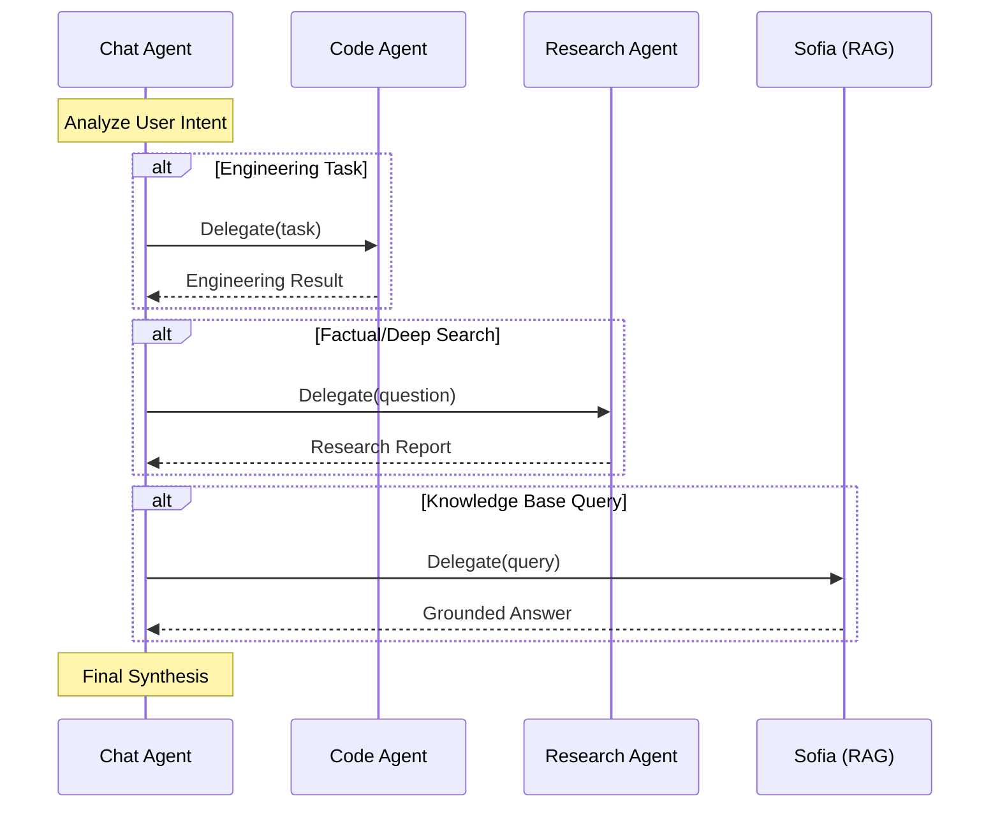

# Agents Master

## Overview
WaNexus uses a "Council of Agents" approach, where a primary Router supervises several specialized sub-agents. Each agent is designed for a specific domain—from complex engineering to deep data research.

---

## 🤖 1. Chat Agent (The Router)
The primary interface between the Go runtime and the reasoning core.
- **Workflow**: Trigger -> Intent Analysis -> Context Loading -> Reasoning/Tool Selection -> Synthesis.
- **Tools**: Has access to all system tools (FileX, TerminalX, WebSearch, etc.).
- **Specialty**: Handles context management, summarization, and human-in-the-loop safety.

---

## 💻 2. Code Agent (The Engineer)
Specialized engineering sub-agent using the **Claude Agent SDK**.
- **Workflow**: Supervisor Call -> Workspace Mapping -> Iterative Reasoning -> Terminal/File Execution.
- **Specialty**: Complex multi-step tasks, debugging, and repository exploration within a sandboxed `playground/`.

---

## 📊 3. Research Agent (The Analyst)
A data-gathering powerhouse using parallel search strategies.
- **Workflow**: Query Generation -> Parallel Web/Wikipedia Search -> Barrier Sync -> Detailed Report Synthesis.
- **Specialty**: High-throughput research requiring multiple sources and structured data extraction.

---

## 💬 4. Reply Agent (Sofia)
A context-aware agent specialized in **Retrieval-Augmented Generation (RAG)**.
- **Workflow**: Retrieve (Vector Search) -> Inject Context -> Generate Grounded Answer.
- **Specialty**: Answering questions based on local knowledge bases and uploaded documents with high accuracy and source traceability.

---

## 🔄 Agent Cooperation Flow
<!-- Agent cooperation sequence -->

---
## Related Documents
- [Architecture Master](../architecture/master-architecture.md)
- [Brain Master](../brain/master-brain.md)
