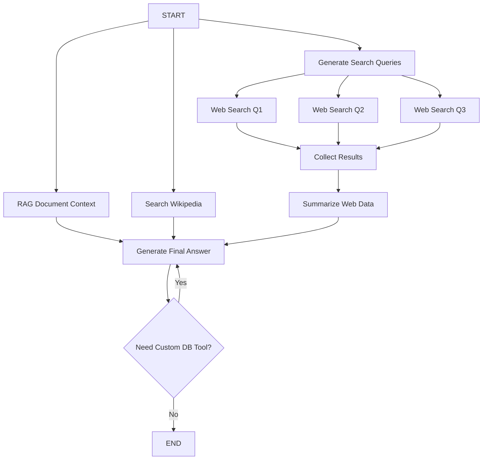

# Research Agent (MR.Senku)

## Overview
The **Research Agent** (implemented as `ResearchAgentUsecase`), known as **MR.Senku**, is a specialized analyst designed to answer complex factual questions by gathering and synthesizing information from multiple web sources, databases, and relevant vector context. It uses a **Parallel Fan-out/Fan-in** strategy to maximize speed and coverage.

## Workflow

<!-- Research Agent execution sequence -->

## Step-by-Step Workflow
1. **Trigger**: Handled via the `research_agent_tool` invoked by the Chat Agent, or endpoint requests.
2. **Decomposition & Parallel Retrieval**:
    - **`generate_query_search_prompt`**: Breaks the user's question into 3-5 distinct search queries.
    - **`retrieve`**: Checks `DocumentLoader`'s `REASEARCH_AGENT` collection for direct RAG context.
    - **`search_wikipedia`**: Searches Wikipedia for broad contextual background.
3. **Parallel Execution**:
    - Dispatches multiple parallel `Send` requests to fetch real-time data for each web query.
4. **Synthesis (Fan-in)**:
    - `collect_search_results` act as a barrier node, waiting for all parallel web searches to finish.
    - `summarize_search_results` condenses the raw web data into a structured research briefing.
5. **Final Generation & Tools**: 
    - `generate_answer` combines the Wikipedia context, RAG output, Custom Tool Database output, and the Web research summary to produce a data-driven response.
    - If `execute_custom_tool` or `find_relevant_custom_tools` is requested internally, the answer cycles to `tools` and back to gather further proprietary DB details.

## Tool Access
- **`WebSearchTool`**: Performs the actual web and Wikipedia searches.
- **`TimeTool`**: Ensures search queries and answers are contextually relevant to the current time.
- **`ToolsBuilder`**: Executes bespoke external databases / DB lookup queries.
- **`DocumentLoader`**: Specialized vector db retrieval (`REASEARCH_AGENT` collection).
- **`WhatsAppIntegration`**: Final delivery of the research report to the user.

## Technical Advantages
- **High Throughput**: By using parallel `Send` nodes in LangGraph, the agent can perform 5+ web searches in the time it would take to do one.
- **Data-Driven**: The system is instructed to prioritize "Numbers, value ranges, percentages, and volumes" in its summaries.
- **Structured Synthesis**: The `SummarizeSearch` node uses a specific 5-point executive summary format to ensure consistency and professional-grade reporting.

## Output Contract
- **Type**: `AIMessage`.
- **Content**: A detailed report including an Executive Summary, Key Facts per Topic, Cross-source comparison, and Actionable conclusions.

## Related Documents
- [Chat Agent](chat-agent.md) — The main router.
- [Reply Agent](reply-agent.md) — For comparison with RAG-based research.
- [Orchestration](../brain/orchestration.md) — LangGraph parallel patterns.
