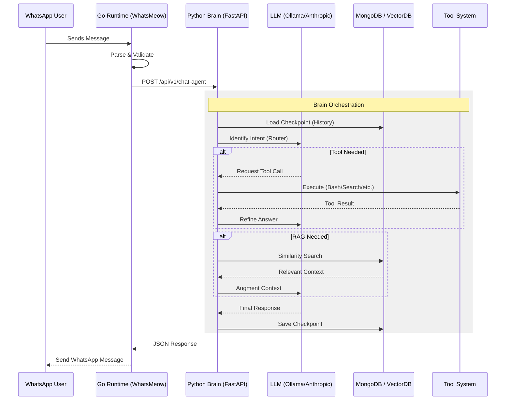

# Data Flow

## Overview
This document describes the lifecycle of a message within the WaNexus system, from the moment a user sends a message on WhatsApp to the point where an AI-generated response is delivered back to them.

## Message Lifecycle

<!-- Message lifecycle sequence diagram -->

## Step-by-Step Flow

### 1. Ingestion (Go Core)
When a message arrives, the Go runtime captures it via the `whatsmeow` event handler. It extracts metadata (sender number, group ID, timestamp) and the content (text, image, or file).

### 2. Forwarding (HTTP Bridge)
The Go service acts as a proxy, forwarding the message to the Brain API. It selects the appropriate endpoint based on the bot's current state or specific command triggers.

### 3. Processing (Brain Orchestration)
The Brain API receives the request and initializes a LangGraph execution:
- **Checkpoint Loading**: Retrieves previous conversation history from MongoDB using the `thread_id`.
- **Reasoning Loop**: The Router Agent analyzes the input. If it's a coding task, it hands off to the Code Agent. If it's a factual query, it invokes the Research Agent.
- **Tool Execution**: If the AI decides to use a tool (e.g., `websearch`), the execution pauses, the tool is run, and the result is fed back into the model.

### 4. Completion & Storage
Once a final response is generated, the state is updated in MongoDB. This ensures that the next message from the same user has full context of the current turn.

### 5. Delivery (Go Core)
The final string or file path is returned to the Go service, which then uses the WhatsApp connection to deliver the message to the user's device.

## Technical Noteworthy
- **Asynchronous Tooling**: For long-running tasks (like `run_worker` in the Code Agent), the system can dispatch background jobs and send progress updates to the user asynchronously, preventing HTTP timeouts.
- **Checkpointing**: By using LangGraph's checkpointer, the system survives restarts and can resume complex multi-turn reasoning loops.

## Related Documents
- [System Overview](system-overview.md) — Architectural map.
- [Chat Agent](../agents/chat-agent.md) — Detailed routing logic.
- [Reply Agent](../agents/reply-agent.md) — RAG flow details.
