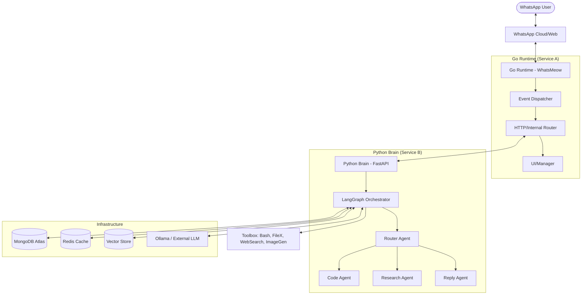
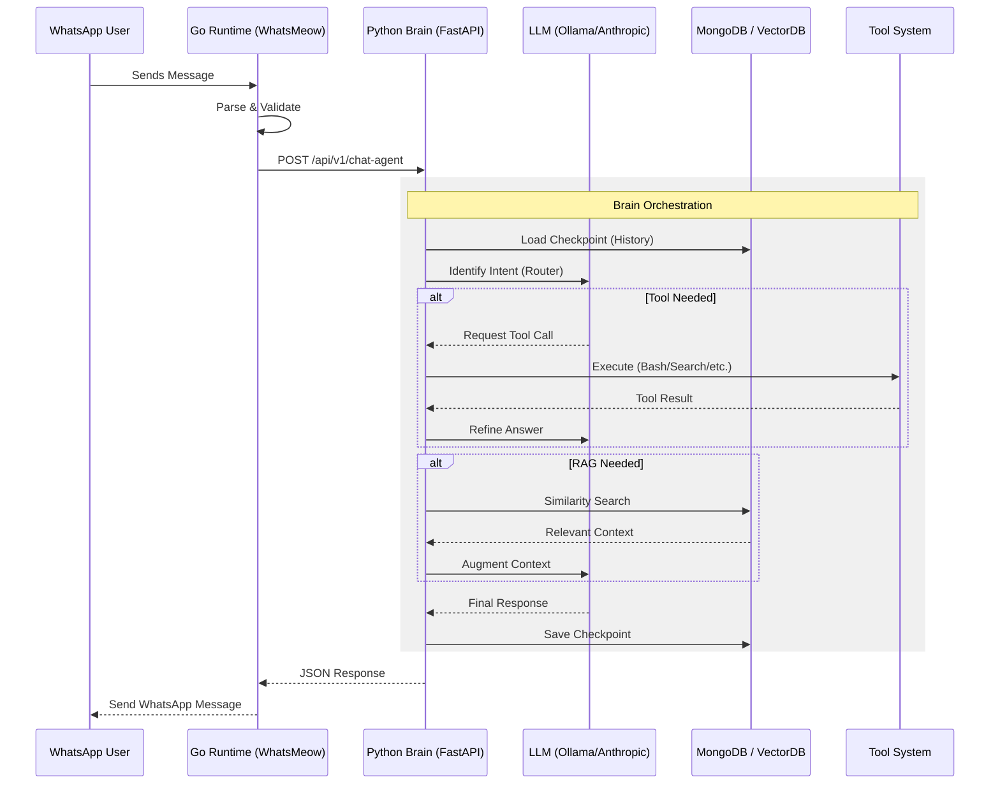

# Architecture Master

## Overview
WaNexus is built on a **Dual-Core Microservice Architecture**, separating high-concurrency communication handling (Go) from complex cognitive reasoning (Python). This separation allows for maximum throughput in message processing while enabling heavy-duty LLM orchestration and tool execution in an isolated reasoning environment.

---

## 🏗️ System Overview

### High-Level Architecture
<!-- Full component map of the WaNexus system -->

### Core Components
1. **Go Runtime (The Communicator)**: Handles persistent connection to WhatsApp, session management, and message ingestion.
2. **Python Brain (The Reasoning Engine)**: Handles intent routing, tool orchestration, and autonomous execution via LangGraph.
3. **Data & Infrastructure**: MongoDB for state, Redis for cache, Vector Store for RAG, and Ollama for local LLMs.

---

## 🔄 Data Flow

### Message Lifecycle
<!-- Message lifecycle sequence diagram -->

### Step-by-Step Lifecycle
1. **Ingestion**: WhatsApp message captured by Go client.
2. **Forwarding**: Metadata and content forwarded to Brain API.
3. **Processing**: LangGraph orchestrates history loading, intent routing, and tool usage.
4. **Completion**: Response generated and state persisted in MongoDB.
5. **Delivery**: Response returned to Go and sent via WhatsApp.

---
## Related Documents
- [Brain Master](../brain/master-brain.md)
- [Agents Master](../agents/master-agents.md)
