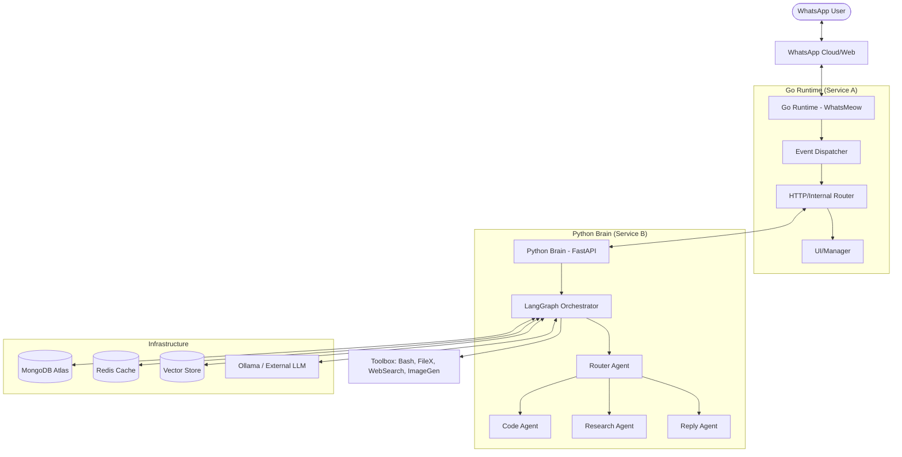

# System Overview

## Overview
WaNexus is built on a **Dual-Core Microservice Architecture**, separating high-concurrency communication handling (Go) from complex cognitive reasoning (Python). This separation allows for maximum throughput in message processing while enabling heavy-duty LLM orchestration and tool execution in an isolated reasoning environment.

## High-Level Architecture

<!-- Full component map of the WaNexus system -->

## Core Components

### 1. Go Runtime (The Communicator)
Written in Go, this component handles the persistent connection to WhatsApp using the `whatsmeow` library. It is responsible for:
- Session management and authentication (QR Code).
- High-performance message ingestion and dispatching.
- Exposing a management UI and REST API for administrative tasks.
- Forwarding message payloads to the Brain API for processing.

### 2. Python Brain (The Reasoning Engine)
A FastAPI-based service that acts as the "Cortex" of the system. It uses LangGraph and LangChain to implement sophisticated agentic behaviors:
- **Intent Routing**: Determining which specialized agent should handle a query.
- **Tool Orchestration**: Safely executing system commands, file operations, and web searches.
- **Memory Management**: Maintaining conversation context and summarizing long-running sessions.
- **Autonomous Execution**: Running complex, multi-step engineering tasks via the Code Agent.

### 3. Data & Infrastructure
- **MongoDB**: Stores configuration, session data, and conversation checkpoints (checkpointer).
- **Redis**: Used for short-term caching and transient session state.
- **Vector Database**: Enables Retrieval-Augmented Generation (RAG) for the Reply Agent.
- **Ollama**: Provides local LLM hosting, ensuring data privacy and offline capability when configured.

## Technical Advantages
- **Scalability**: The Go runtime handles thousands of concurrent messages while the Python backend scales independently for processing-heavy AI tasks.
- **Resilience**: If the Brain API is down, the Go runtime can queue messages or return graceful degradations.
- **Flexibility**: Agents can be added or modified in Python without affecting the core connectivity logic in Go.

## Related Documents
- [Data Flow](data-flow.md) — Detailed message lifecycle.
- [Brain Overview](../brain/overview.md) — Deep dive into the reasoning engine.
- [Tech Stack](../stack/tech-stack.md) — Technologies used in the system.
