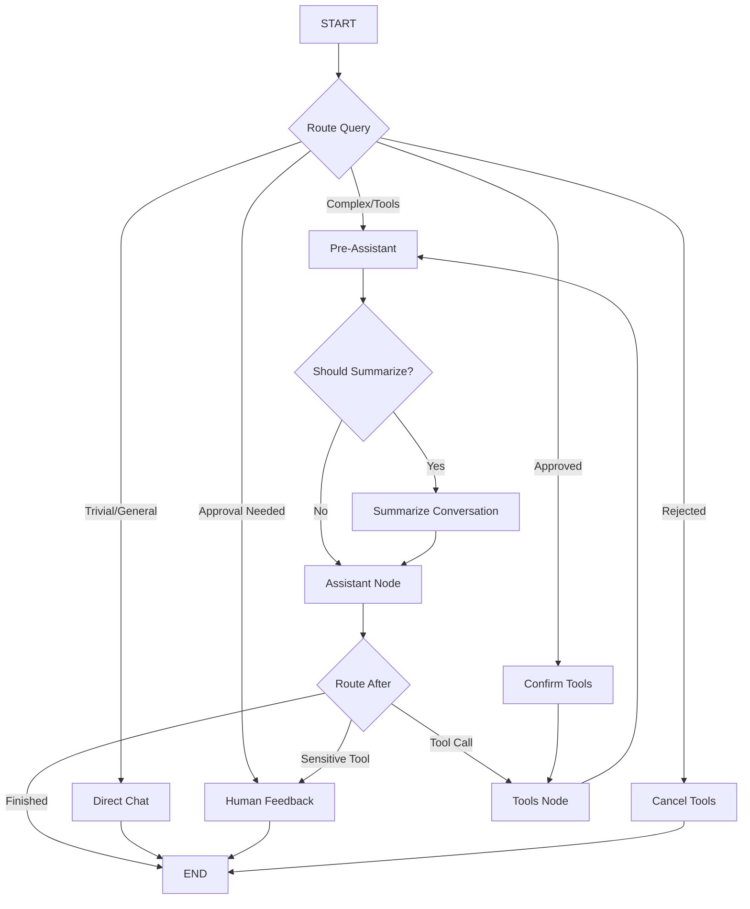

# Brain Master

## Overview
The **Brain Module** is the cognitive center of the WaNexus system. It is a Python-based microservice built with **FastAPI**, **LangChain**, and **LangGraph**. Its primary responsibility is to transform raw user messages into intelligent, goal-oriented actions and responses.

---

## 🧠 Brain Architecture

### Structure and Philosophy
The module follows **Clean Architecture** principles, ensuring that business logic (agents/use cases) remains independent of infrastructure (databases/external APIs).

- **`backend/application/`**: Core logic (agents: Chat, Code, Research, Reply).
- **`backend/domain/`**: Pure domain entities and interfaces.
- **`backend/interface/`**: API routers and adapters.
- **`backend/bootstrap/`**: DI and app factory.

### Core Capabilities
1. **Multi-Agent Orchestration**: Router (ChatAgent) delegates to specialized sub-agents.
2. **Stateful Reasoning**: LangGraph maintains history, summaries, and tool memory.
3. **Integrated Toolset**: Direct access to TerminalX, FileX, WebSearch, and WhatsApp.

---

## 🏗️ Orchestration Logic

### Graph Topology
The coordination between different nodes is managed by a cyclic directed graph in LangGraph.

<!-- Agent routing decision flow -->

### Key Logic Nodes
- **`RouteQuery`**: Filters incoming intent early.
- **`Summarize`**: Condenses history when context window threshold is reached.
- **`Assistant`**: The primary decision-making LLM node.
- **`HumanFeedback`**: Interruption node for sensitive/risky tool confirmation.
- **`Tools`**: Deterministic tool execution node.

---
## Related Documents
- [Architecture Master](../architecture/master-architecture.md)
- [Agents Master](../agents/master-agents.md)
