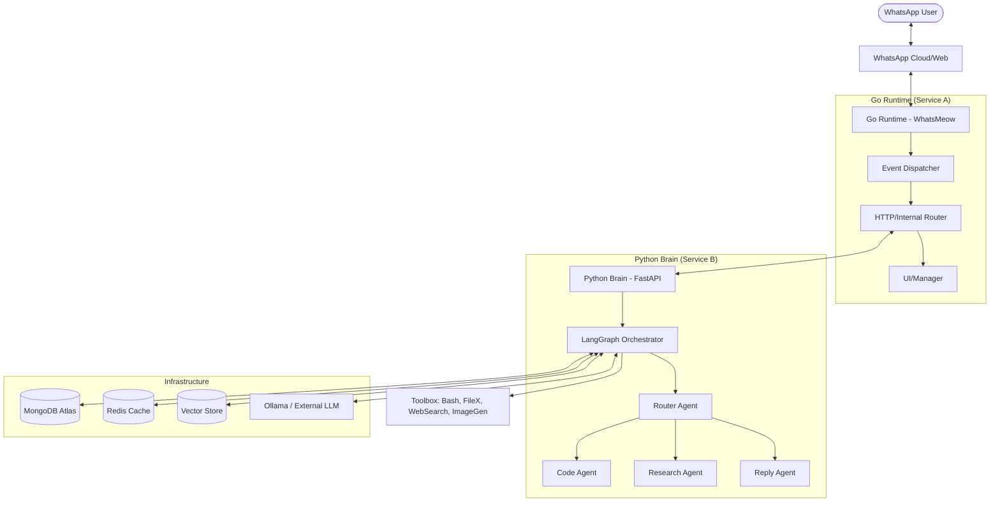
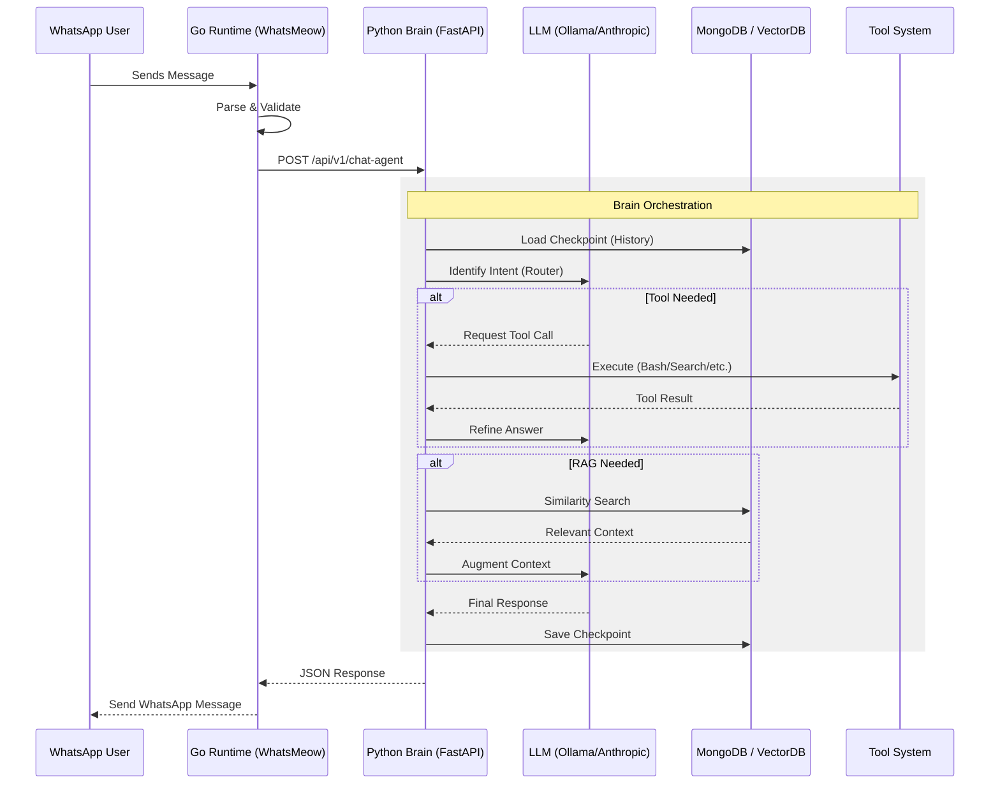
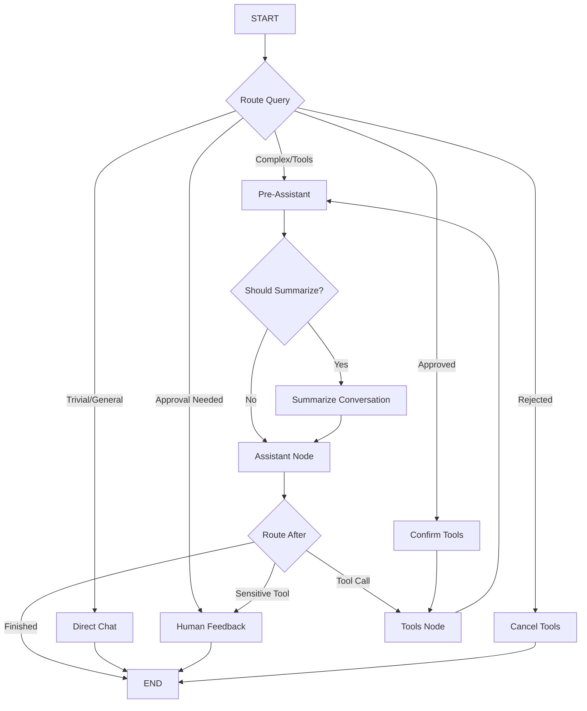

# WaNexus: Complete System Documentation

This document provides a consolidated, comprehensive overview of the WaNexus AI Agent system, including its architecture, the cognitive brain module, and specialized agent workflows. For directory-specific master files, please see the [Master Directories](./README.md#master-directories).

---

## 🏛️ System Architecture

### Overview
WaNexus is built on a **Dual-Core Microservice Architecture**, separating high-concurrency communication handling (Go) from complex cognitive reasoning (Python). This separation allows for maximum throughput in message processing while enabling heavy-duty LLM orchestration and tool execution in an isolated reasoning environment.

### High-Level Architecture
<!-- Full component map of the WaNexus system -->

### Data Flow & Message Lifecycle
<!-- Message lifecycle sequence diagram -->

---

## 🧠 Brain Module & Orchestration

### Brain Overview
The **Brain Module** is the cognitive center of the WaNexus system. It is a Python-based microservice built with **FastAPI**, **LangChain**, and **LangGraph**. Its primary responsibility is to transform raw user messages into intelligent, goal-oriented actions and responses.

### Orchestration & Graph Logic
The coordination between different nodes, agents, and tools is managed by **LangGraph**. The system uses a cyclic directed graph to manage the conversation flow.

<!-- Agent routing decision flow -->

#### Key Orchestration Nodes
1.  **`RouteQuery`**: Early intent filter determining if the message is simple or requires advanced tools.
2.  **`PreAssistant` & `SummarizeConversation`**: Automatically condenses history to fit within context windows.
3.  **`Assistant`**: The main reasoning node that decides whether to answer directly or invoke a tool.
4.  **`Tools`**: Executes requested tool calls and feeds results back into the graph.
5.  **`HumanFeedback`**: Safety gate that pauses execution for sensitive actions (e.g., file deletion).

---

## 🤖 Specialized Agents

### 1. Chat Agent (Router)
The **Chat Agent** acts as both a Router and a Supervisor. It manages the main LangGraph workflow and orchestrates tool usage.
- **Tool Access**: TimeTool, WebSearch, FileX, TerminalX, WhatsAppIntegration, AgentCode.
- **Technical Advantage**: Features custom tool coercion for models without native tool-calling support.

### 2. Code Agent (Engineer)
Designed for complex engineering tasks using the **Claude Agent SDK**.
- **Capabilities**: Iterative reasoning, file editing, and terminal execution within a sandboxed playground.
- **Workflow**: Planning -> Execution (Bash/Read/Write/Edit) -> Progress Notifications (WhatsApp) -> Completion.

### 3. Research Agent (Analyst)
Uses a **Parallel Fan-out/Fan-in** strategy to synthesize information from web sources.
- **Workflow**: Generate Queries -> Parallel Web/Wikipedia Search -> Result Barrier -> Synthesis -> Detailed Report.
- **Technical Advantage**: High throughput via parallel LangGraph `Send` requests.

### 4. Reply Agent (Sofia)
A specialized conversationalist using **Retrieval-Augmented Generation (RAG)**.
- **Capabilities**: Answers questions based on a local MongoDB Vector Store knowledge base.
- **Technical Advantage**: Grounded responses with score thresholding and source traceability.

---

## 🚀 Technical Advantages Summary
- **Scalability**: Split Go/Python architecture handles high concurrency and heavy processing separately.
- **Resilience**: State persistence via MongoDB checkpointers allows resuming from any point.
- **Safety**: Human-in-the-loop gates for destructive commands.
- **Extensibility**: Clean Architecture makes it easy to add new agents or tools without breaking core connectivity.

---
*Generated by Antigravity AI — 2026-05-03*
